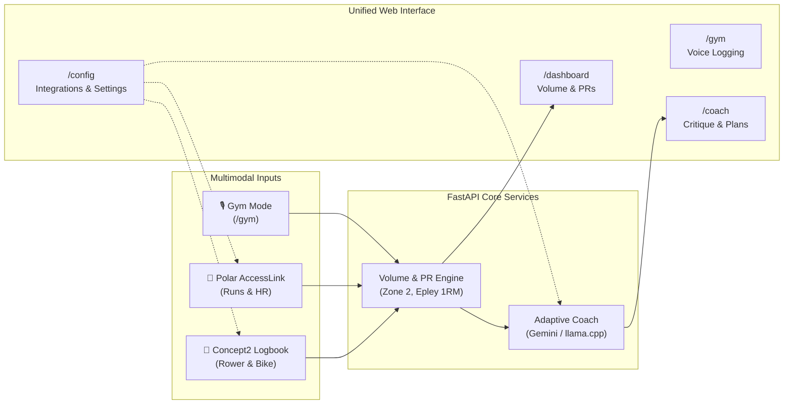

# Coach3

Self-hosted workout tracker, volume analytics, and adaptive AI fitness coach.

Coach3 runs entirely on user-controlled hardware (local desktop, home server, or homelab container), keeping cardiovascular telemetry, biometrics, audio transcripts, and coaching philosophies private.

---

## Architecture & Core Features

Coach3 brings together 4 integrated modules accessible through a unified web shell:



1. **🎙️ Gym Voice Logging (`/gym`)**: Mobile-optimized voice logging for strength workouts. Spoken sets, reps, load, and RPE are transcribed and parsed into structured sets with one-tap editing.
2. **📊 Training Volume & Performance Dashboard (`/dashboard`)**: Separate weekly goal-tracked macro charts for **Zone 2 Cardio** (`120 min/wk` goal) and **VO2 Max Training** (`20 min/wk` Zone 5 goal), plus **Push / Pull / Legs / Abs** resistance volume (`10 sets/wk` goal each, top loads & estimated 1RM). Features preset and custom date-range filters and an interactive workouts table that expands to show notes, strength working sets, self-hosted Mercator SVG GPS route maps, synchronized dual-axis heart rate & pace curves, Multi-Set Pace + HR overlays, and clickable single-interval `Workout Graph` charts.
3. **🤖 Adaptive AI Coaching (`/coach`)**: Retrospective workout critiques (Analysis Mode) and periodized 7-day or 14-day microcycles (Planning Mode) guided by your training philosophy, running on either Google Gemini or private local `llama.cpp`.
4. **⚙️ Integrations & Settings Hub (`/config`)**: In-browser configuration for Polar AccessLink, Concept2 Logbook, and AI inference engines with copyable OAuth redirect URIs, live diagnostic health checks, and instant demo data seeding.

---

## Quickstart & Local Setup

### 1. Prerequisites
- Python 3.12+
- PostgreSQL 16 (or Docker Compose)

### 2. Environment Configuration
Copy the example environment file and configure your encryption key:
```bash
cp .env.example .env
```
Generate an encryption key:
```bash
python -c "from cryptography.fernet import Fernet; print(Fernet.generate_key().decode())"
```
Set `ENCRYPTION_KEY` in your `.env` file.

### 3. Start Database & Run Migrations
```bash
# Start PostgreSQL via Docker Compose
docker compose up -d db

# Run database migrations
.venv/bin/alembic upgrade head
```

### 4. Start the Application Server
```bash
.venv/bin/uvicorn src.main:app --reload --port 8000
```

---

## Web Interfaces

Once the server is running, open your desktop or iPhone Safari browser:

| Interface | URL | Purpose |
| :--- | :--- | :--- |
| **Settings & Setup** | `http://localhost:8000/config` | Setup guide for Polar, Concept2, AI providers, and demo data tools. |
| **Gym Voice Logger** | `http://localhost:8000/gym` | Mobile voice input for sets, reps, weight, and RPE. |
| **Volume Dashboard** | `http://localhost:8000/dashboard` | Visualizes weekly volume, Zone 2 hours, and PR showcase. |
| **AI Fitness Coach** | `http://localhost:8000/coach` | Philosophy steering, workout critiques, and training plan calendar. |
| **API Docs (Swagger)** | `http://localhost:8000/docs` | Interactive API documentation for all endpoints. |

---

## Connecting Third-Party Integrations

### Polar AccessLink (Outdoor Running & Heart Rate)
1. Register an application at [flow.polar.com](https://flow.polar.com) (Developer Portal).
2. Set the **Redirect URI** to `http://localhost:8000/api/v1/integrations/polar/callback` (or copy it directly from `/config`).
3. Enter your **Client ID** and **Client Secret** on `/config` and click **Save Credentials**.
4. Click **Connect Polar** to complete authorization.
5. Click **Verify Connection** to run a diagnostic health check.

### Concept2 Logbook (Rower & Erg Bike)
1. Register an application at [log.concept2.com/developers](https://log.concept2.com/developers).
2. Set the **Redirect URI** to `http://localhost:8000/api/v1/integrations/concept2/callback`.
3. Enter your **Client ID** and **Client Secret** on `/config` and click **Save Credentials**.
4. Click **Connect Concept2** to complete authorization.
5. Click **Verify Connection** to confirm token validity.

---

## Demo Data & Testing Tools

To explore the dashboard and coach without waiting for real workout syncs:
- **From UI**: Visit `http://localhost:8000/config` and click **Load Sample Workouts**.
- **From Terminal**:
  ```bash
  python -m src.scripts.seed_demo
  ```
- **Reset Demo Data**: Click **Reset Demo Data** on `/config` or run:
  ```bash
  python -m src.scripts.seed_demo --reset
  ```
  *(Note: Purges only synthetic demo records with `is_demo=True`; authentic athlete workouts and credentials are never deleted.)*

---

## Running Tests

Run the full automated test suite with pytest:
```bash
.venv/bin/pytest
```

---

## Constitution & Data Sovereignty

Coach3 operates under the strict guidelines of `.specify/memory/constitution.md`:
* **Data Sovereignty**: 100% of telemetry, workout logs, and credentials reside on self-hosted storage.
* **Privacy Scrubbing**: Outbound cloud prompts (Gemini API) are automatically stripped of athlete names, email addresses, and GPS route coordinates traces.
* **Idempotency**: Repeated sync retries or voice entries never produce duplicate workout sessions.
