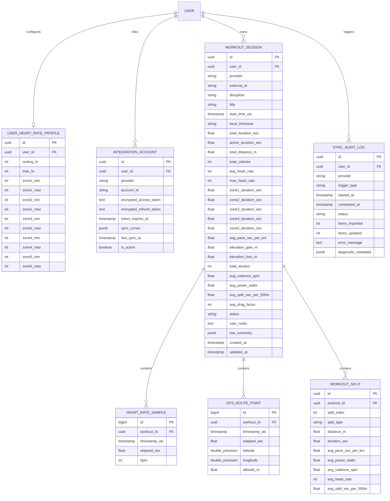

# Data Model: Core Ingestion & Telemetry Schema

**Feature Branch**: `001-data-ingestion`
**Date**: 2026-11-17
**Status**: Completed

## 1. Relational Entity Relationship Diagram

---

## 2. Table Definitions & Constraints

### `integration_account`
Stores encrypted provider credentials and synchronization watermarks.
- **Constraints**:
  - `PRIMARY KEY (id)`
  - `FOREIGN KEY (user_id) REFERENCES user (id) ON DELETE CASCADE`
  - `UNIQUE (user_id, provider)`
  - `CHECK (provider IN ('polar', 'concept2'))`

### `user_heart_rate_profile`
Maintains individual heart rate zones for local zone calculation.
- **Constraints**:
  - `PRIMARY KEY (id)`
  - `FOREIGN KEY (user_id) REFERENCES user (id) ON DELETE CASCADE`
  - `UNIQUE (user_id)`
  - `CHECK (resting_hr > 30 AND max_hr < 240 AND resting_hr < max_hr)`
  - `CHECK (zone1_min < zone1_max AND zone1_max <= zone2_min AND zone2_min < zone2_max AND zone2_max <= zone3_min ...)`

### `workout_session`
Canonical normalized entity for all endurance activities.
- **Constraints**:
  - `PRIMARY KEY (id)`
  - `FOREIGN KEY (user_id) REFERENCES user (id) ON DELETE CASCADE`
  - `UNIQUE (provider, external_id)` — **Enforces Ingestion Idempotency**
  - `CHECK (discipline IN ('outdoor_run', 'indoor_row', 'erg_bike'))`
  - `CHECK (status IN ('active', 'archived_upstream'))`
- **Indexes**:
  - `CREATE INDEX idx_workout_user_date ON workout_session (user_id, start_time_utc DESC);`
  - `CREATE INDEX idx_workout_discipline ON workout_session (user_id, discipline, start_time_utc DESC);`

### `heart_rate_sample`
Time-series cardiovascular samples.
- **Constraints**:
  - `PRIMARY KEY (id)`
  - `FOREIGN KEY (workout_id) REFERENCES workout_session (id) ON DELETE CASCADE`
- **Indexes**:
  - `CREATE INDEX idx_hr_workout_elapsed ON heart_rate_sample (workout_id, elapsed_sec ASC);`

### `gps_route_point`
High-resolution geographic coordinate stream for outdoor runs.
- **Constraints**:
  - `PRIMARY KEY (id)`
  - `FOREIGN KEY (workout_id) REFERENCES workout_session (id) ON DELETE CASCADE`
- **Indexes**:
  - `CREATE INDEX idx_gps_workout_elapsed ON gps_route_point (workout_id, elapsed_sec ASC);`

### `workout_split`
Sub-session segment metrics (kilometer splits, 500m intervals).
- **Constraints**:
  - `PRIMARY KEY (id)`
  - `FOREIGN KEY (workout_id) REFERENCES workout_session (id) ON DELETE CASCADE`
- **Indexes**:
  - `CREATE INDEX idx_split_workout_order ON workout_split (workout_id, split_index ASC);`

### `sync_audit_log`
Tracks operational health, audit history, and error diagnostics.
- **Constraints**:
  - `PRIMARY KEY (id)`
  - `FOREIGN KEY (user_id) REFERENCES user (id) ON DELETE CASCADE`
- **Indexes**:
  - `CREATE INDEX idx_sync_log_user ON sync_audit_log (user_id, started_at DESC);`
