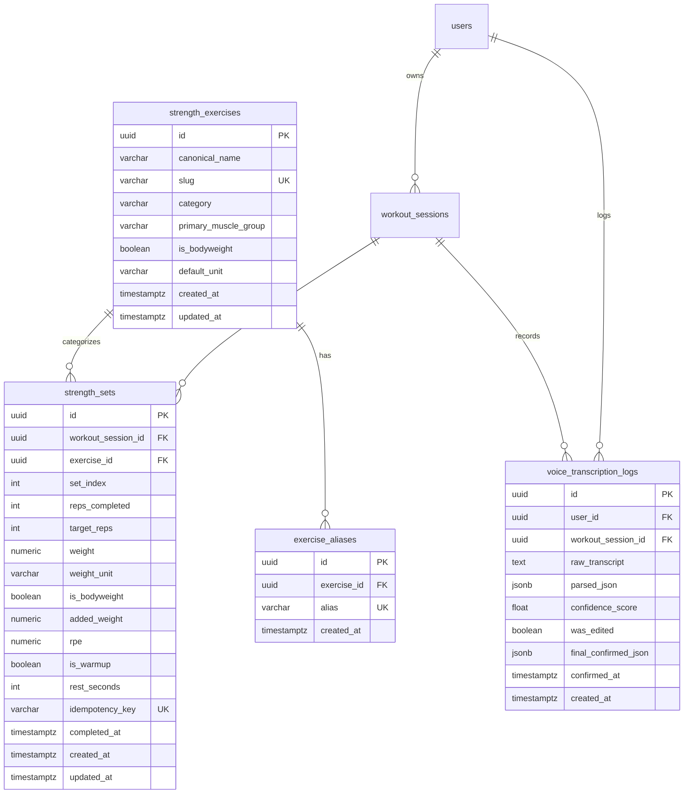

# Phase 1 Data Model: Gym Mode Natural Language Workout Logging

**Feature**: `002-gym-voice-logging`  
**Date**: 2026-11-17  
**Status**: Completed

## 1. Relational Schema Architecture

Feature 002 extends the Coach3 database schema with 4 new tables, linking strength exercise definitions, aliases, discrete logged sets, and voice parsing audit logs back to `workout_sessions` and `users`.

---

## 2. Table Specifications

### 2.1 `strength_exercises`
Master dictionary of allowable strength, Olympic, and calisthenic movements.
- `id`: UUID, Primary Key.
- `canonical_name`: VARCHAR(120), Not Null (e.g. `"Barbell Back Squat"`).
- `slug`: VARCHAR(120), Unique, Not Null (e.g. `"barbell-back-squat"`).
- `category`: VARCHAR(50), Not Null (`barbell`, `dumbbell`, `bodyweight`, `machine`, `cable`).
- `primary_muscle_group`: VARCHAR(50), Not Null (`chest`, `quadriceps`, `hamstrings`, `back`, `shoulders`, `arms`, `core`, `full_body`).
- `is_bodyweight`: BOOLEAN, Not Null, Default `FALSE`.
- `default_unit`: VARCHAR(10), Not Null, Default `'lbs'` (`lbs`, `kg`).
- `created_at`, `updated_at`: TIMESTAMPTZ, Default `NOW()`.

### 2.2 `exercise_aliases`
Fuzzy and colloquial synonyms mapping to canonical exercises.
- `id`: UUID, Primary Key.
- `exercise_id`: UUID, Not Null, Foreign Key $\to$ `strength_exercises(id)` on delete CASCADE.
- `alias`: VARCHAR(120), Unique, Not Null (e.g. `"squats"`, `"back squat"`, `"high bar squat"`).
- `created_at`: TIMESTAMPTZ, Default `NOW()`.

### 2.3 `strength_sets`
Discrete performed sets linked to an active or completed `workout_sessions` row (`sport_type = 'strength'`).
- `id`: UUID, Primary Key.
- `workout_session_id`: UUID, Not Null, Foreign Key $\to$ `workout_sessions(id)` on delete CASCADE.
- `exercise_id`: UUID, Not Null, Foreign Key $\to$ `strength_exercises(id)` on delete RESTRICT.
- `set_index`: INTEGER, Not Null (1-based index within the session/exercise).
- `reps_completed`: INTEGER, Not Null (e.g., `8`).
- `target_reps`: INTEGER, Nullable (e.g., `8` if prescribed).
- `weight`: NUMERIC(7, 2), Not Null, Default `0.0` (barbell/dumbbell load or `0.0` if bodyweight).
- `weight_unit`: VARCHAR(10), Not Null, Default `'lbs'` (`lbs`, `kg`).
- `is_bodyweight`: BOOLEAN, Not Null, Default `FALSE`.
- `added_weight`: NUMERIC(7, 2), Not Null, Default `0.0` (positive for weight belt/vest, negative for assisted counterweight).
- `rpe`: NUMERIC(3, 1), Nullable (Rate of Perceived Exertion, 1.0 to 10.0).
- `is_warmup`: BOOLEAN, Not Null, Default `FALSE`.
- `rest_seconds`: INTEGER, Nullable (rest time before or after set).
- `idempotency_key`: VARCHAR(100), Unique, Nullable (client-generated UUID to prevent duplicate writes).
- `completed_at`: TIMESTAMPTZ, Not Null, Default `NOW()`.
- `created_at`, `updated_at`: TIMESTAMPTZ, Default `NOW()`.

### 2.4 `voice_transcription_logs`
Audit history of speech transcripts, model predictions, user edits, and latency metadata.
- `id`: UUID, Primary Key.
- `user_id`: UUID, Not Null, Foreign Key $\to$ `users(id)` on delete CASCADE.
- `workout_session_id`: UUID, Nullable, Foreign Key $\to$ `workout_sessions(id)` on delete SET NULL.
- `raw_transcript`: TEXT, Not Null.
- `parsed_json`: JSONB, Not Null (the raw parser output before user review).
- `confidence_score`: FLOAT, Not Null.
- `was_edited`: BOOLEAN, Not Null, Default `FALSE`.
- `final_confirmed_json`: JSONB, Nullable (what was actually committed).
- `confirmed_at`: TIMESTAMPTZ, Nullable.
- `created_at`: TIMESTAMPTZ, Default `NOW()`.

---

## 3. Ingestion & Validation Rules

1. **Bodyweight Load Separation**:
   - For `is_bodyweight = true` (e.g. Pull-Up, Dip, Push-Up):
     - `weight` is recorded as `0.0`.
     - `added_weight` captures external resistance added (+30.0 lbs) or machine assistance (-20.0 lbs).
   - For barbell/dumbbell exercises:
     - `weight` is the total barbell/dumbbell resistance (e.g., 185.0 lbs).
     - `added_weight` is `0.0`.
2. **Idempotency Guarantee**:
   - `idempotency_key` guarantees that repeated taps or retry packets on mobile will return the existing record without appending duplicate sets.
3. **Session Linking**:
   - When sets are submitted, if `workout_session_id` is passed, sets are appended to that session. If omitted or null, the system automatically appends to the athlete's most recent active strength session (created within the last 4 hours) or creates a new `workout_sessions` row with `sport_type = 'strength'`.
