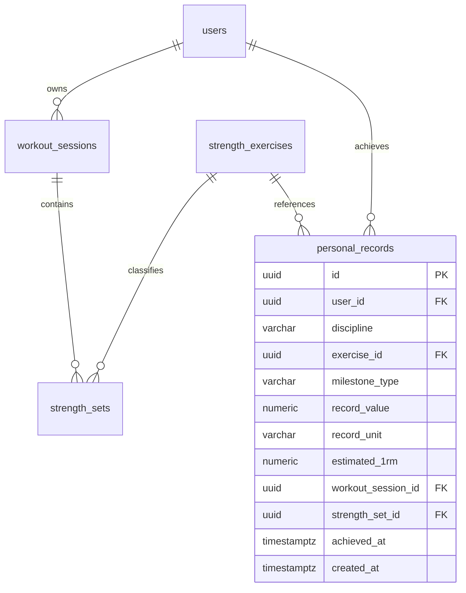

# Phase 1 Data Model & Analytics Schema: Volume Modeling & Performance Dashboard

**Feature**: `003-volume-dashboard`  
**Date**: 2026-11-17  
**Status**: Completed

## 1. Domain Entities & Analytical Aggregates

Feature 003 models aggregated analytics across the existing relational tables (`workout_sessions`, `strength_sets`, `strength_exercises`, `users`), plus an optional lightweight `personal_records` cache/log table for historical PR badge tracking and timeline viewing.

---

## 2. Table Specification: `personal_records`

Records every historical personal record breakthrough achieved by an athlete.
- `id`: UUID, Primary Key.
- `user_id`: UUID, Not Null, Foreign Key $\to$ `users(id)` on delete CASCADE.
- `discipline`: VARCHAR(50), Not Null (`strength`, `outdoor_run`, `indoor_row`, `erg_bike`).
- `exercise_id`: UUID, Nullable, Foreign Key $\to$ `strength_exercises(id)` on delete CASCADE (for strength PRs).
- `milestone_type`: VARCHAR(50), Not Null (e.g. `'weight_pr'`, `'estimated_1rm_pr'`, `'repetition_pr'`, `'1_mile'`, `'5k'`, `'10k'`, `'500m_erg'`, `'2k_erg'`, `'5k_erg'`).
- `record_value`: NUMERIC(10, 2), Not Null (e.g., weight in lbs, pace in sec/km, or time in sec).
- `record_unit`: VARCHAR(20), Not Null (`lbs`, `kg`, `sec`, `sec_per_km`, `sec_per_500m`, `reps`).
- `estimated_1rm`: NUMERIC(7, 2), Nullable (Epley estimate if strength set).
- `workout_session_id`: UUID, Nullable, Foreign Key $\to$ `workout_sessions(id)` on delete SET NULL.
- `strength_set_id`: UUID, Nullable, Foreign Key $\to$ `strength_sets(id)` on delete SET NULL.
- `achieved_at`: TIMESTAMPTZ, Not Null.
- `created_at`: TIMESTAMPTZ, Default `NOW()`.

---

## 3. Pydantic Analytical Domain Models

### 3.1 `UnifiedVolumeSummary`
- `start_date`: Date / DateTime
- `end_date`: Date / DateTime
- `cardio`:
  - `total_distance_km`: Float
  - `total_distance_miles`: Float
  - `total_duration_hours`: Float
  - `zone2_duration_hours`: Float
  - `zone2_percentage`: Float (e.g. `78.4%`)
  - `zone_distribution`: Dict[str, float] (hours per Zone 1–5)
  - `outdoor_run_km`: Float
  - `erg_row_meters`: Float
  - `erg_bike_meters`: Float
- `strength`:
  - `total_volume_load_lbs`: Float
  - `effective_working_sets`: Int
  - `total_reps`: Int
  - `muscle_group_sets`: Dict[str, int] (e.g. `{"chest": 12, "back": 18, "quadriceps": 16}`)
  - `muscle_group_volume`: Dict[str, float] (tonnage per muscle group)
  - `added_calisthenic_load_lbs`: Float

### 3.2 `PersonalRecordSummary`
- `discipline`: String
- `title`: String (e.g. `"Barbell Back Squat Estimated 1RM"`, `"5k Outdoor Run"`)
- `exercise_name`: Optional String
- `milestone_type`: String
- `record_display`: String (e.g. `"315 lbs"`, `"21:45"`, `"1:38.2 / 500m"`)
- `record_value`: Float
- `record_unit`: String
- `achieved_at`: DateTime
- `is_recent`: Boolean (achieved within current active window)
