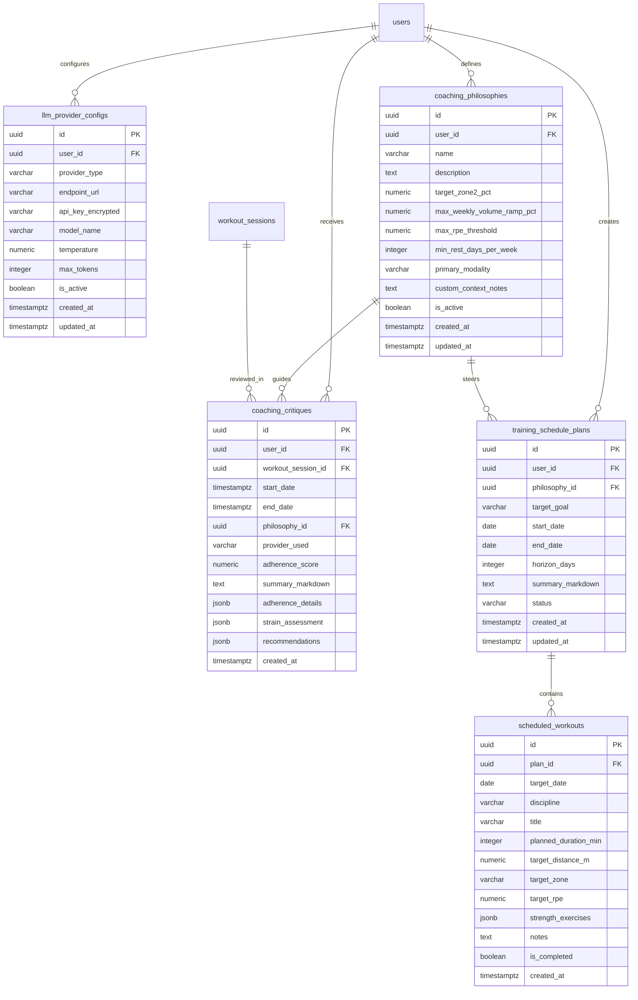

# Phase 1 Data Model: Adaptive AI Coaching Engine

**Feature**: `004-adaptive-ai-coaching`  
**Date**: 2026-11-18  
**Status**: Completed  

---

## 1. Domain Entities & Relationships

Feature 004 introduces four relational entities to manage LLM provider settings, user-defined training philosophies, retrospective workout critiques, and forward-looking periodized training plans:

---

## 2. Table Specifications

### 2.1 Table: `llm_provider_configs`
Stores configuration for LLM backends (Gemini cloud API or local `llama.cpp` server).
- `id`: UUID, Primary Key.
- `user_id`: UUID, Not Null, Foreign Key $\to$ `users(id)` ON DELETE CASCADE.
- `provider_type`: VARCHAR(50), Not Null (`gemini`, `llama_cpp`).
- `endpoint_url`: VARCHAR(255), Not Null.
- `api_key_encrypted`: VARCHAR(500), Nullable (Fernet encrypted key for Gemini; null for local server).
- `model_name`: VARCHAR(100), Not Null (e.g. `gemini-2.5-flash`, `qwen2.5-14b-instruct`).
- `temperature`: NUMERIC(3, 2), Default `0.7`, Not Null.
- `max_tokens`: INTEGER, Default `2048`, Not Null.
- `is_active`: BOOLEAN, Default `FALSE`, Not Null.
- `created_at`: TIMESTAMPTZ, Default `NOW()`.
- `updated_at`: TIMESTAMPTZ, Default `NOW()`.

### 2.2 Table: `coaching_philosophies`
Stores user-customizable training philosophies, steering parameters, and manual context notes.
- `id`: UUID, Primary Key.
- `user_id`: UUID, Not Null, Foreign Key $\to$ `users(id)` ON DELETE CASCADE.
- `name`: VARCHAR(100), Not Null (e.g. "Polarized 80/20 Base", "Progressive Overload", "Custom Hybrid").
- `description`: TEXT, Nullable.
- `target_zone2_pct`: NUMERIC(5, 2), Default `80.0`, Not Null (percentage of cardio in Zone 2).
- `max_weekly_volume_ramp_pct`: NUMERIC(5, 2), Default `10.0`, Not Null (max % weekly increase).
- `max_rpe_threshold`: NUMERIC(3, 1), Default `8.5`, Not Null (warning threshold for set intensity).
- `min_rest_days_per_week`: INTEGER, Default `2`, Not Null.
- `primary_modality`: VARCHAR(50), Default `'hybrid'`, Not Null (`endurance`, `strength`, `hybrid`).
- `custom_context_notes`: TEXT, Nullable (user-provided training books, injury notes, personal rules).
- `is_active`: BOOLEAN, Default `FALSE`, Not Null.
- `created_at`: TIMESTAMPTZ, Default `NOW()`.
- `updated_at`: TIMESTAMPTZ, Default `NOW()`.

### 2.3 Table: `coaching_critiques`
Stores retrospective feedback on completed workouts or weekly training blocks.
- `id`: UUID, Primary Key.
- `user_id`: UUID, Not Null, Foreign Key $\to$ `users(id)` ON DELETE CASCADE.
- `workout_session_id`: UUID, Nullable, Foreign Key $\to$ `workout_sessions(id)` ON DELETE SET NULL.
- `start_date`: TIMESTAMPTZ, Nullable.
- `end_date`: TIMESTAMPTZ, Nullable.
- `philosophy_id`: UUID, Nullable, Foreign Key $\to$ `coaching_philosophies(id)` ON DELETE SET NULL.
- `provider_used`: VARCHAR(50), Not Null (`gemini`, `llama_cpp`).
- `adherence_score`: NUMERIC(4, 1), Not Null (0.0 to 100.0).
- `summary_markdown`: TEXT, Not Null (overall coach feedback).
- `adherence_details`: JSONB, Default `'{}'`.
- `strain_assessment`: JSONB, Default `'{}'`.
- `recommendations`: JSONB, Default `'[]'` (list of actionable adjustments).
- `created_at`: TIMESTAMPTZ, Default `NOW()`.

### 2.4 Table: `training_schedule_plans`
Stores periodized forward-looking training schedules.
- `id`: UUID, Primary Key.
- `user_id`: UUID, Not Null, Foreign Key $\to$ `users(id)` ON DELETE CASCADE.
- `philosophy_id`: UUID, Nullable, Foreign Key $\to$ `coaching_philosophies(id)` ON DELETE SET NULL.
- `target_goal`: VARCHAR(255), Not Null (e.g. "Sub-22 5k prep", "315 lb Squat Peak").
- `start_date`: DATE, Not Null.
- `end_date`: DATE, Not Null.
- `horizon_days`: INTEGER, Default `7`, Not Null (7 or 14).
- `summary_markdown`: TEXT, Not Null.
- `status`: VARCHAR(50), Default `'active'`, Not Null (`active`, `completed`, `superseded`).
- `created_at`: TIMESTAMPTZ, Default `NOW()`.
- `updated_at`: TIMESTAMPTZ, Default `NOW()`.

### 2.5 Table: `scheduled_workouts`
Discrete calendar session entities belonging to a forward schedule plan.
- `id`: UUID, Primary Key.
- `plan_id`: UUID, Not Null, Foreign Key $\to$ `training_schedule_plans(id)` ON DELETE CASCADE.
- `target_date`: DATE, Not Null.
- `discipline`: VARCHAR(50), Not Null (`outdoor_run`, `indoor_row`, `erg_bike`, `strength`, `rest`).
- `title`: VARCHAR(255), Not Null (e.g. "Zone 2 Aerobic Base Run", "Upper Body Heavy Compound").
- `planned_duration_min`: INTEGER, Default `45`, Not Null.
- `target_distance_m`: NUMERIC(10, 2), Nullable.
- `target_zone`: VARCHAR(50), Nullable (e.g. "Zone 2", "Zone 4 intervals").
- `target_rpe`: NUMERIC(3, 1), Nullable.
- `strength_exercises`: JSONB, Nullable (array of `{exercise: str, sets: int, reps: int, target_weight: float, notes: str}`).
- `notes`: TEXT, Nullable.
- `is_completed`: BOOLEAN, Default `FALSE`, Not Null.
- `created_at`: TIMESTAMPTZ, Default `NOW()`.

---

## 3. Seed Data Presets
When migrations execute, seed three canonical coaching philosophies:
1. **Polarized 80/20 Endurance**: 80% Zone 2 cardio, 20% high intensity (Zone 4/5), max 10% weekly mileage ramp, 2 rest days.
2. **Progressive Overload Resistance**: Wave periodization, max RPE 8.5 threshold, 10% max weekly volume tonnage increase, 2-3 recovery days.
3. **Hybrid Athletic Conditioning**: Concurrent endurance and strength without interference, 75% Zone 2, max RPE 8.5, 2 full rest/recovery days.
